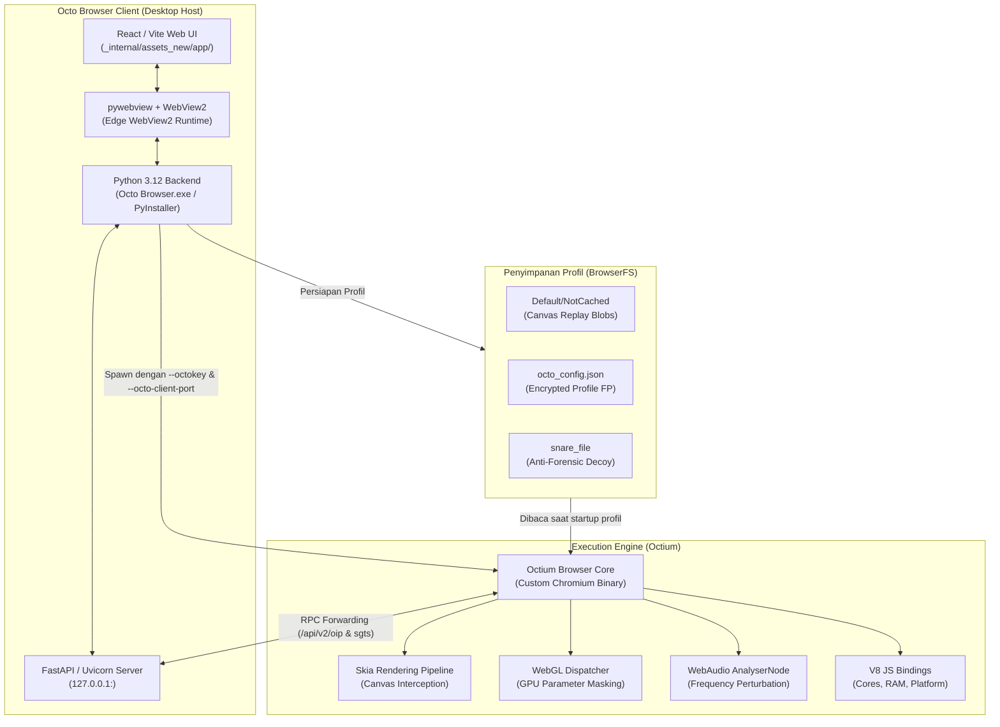

# Laporan Komprehensif Reverse Engineering: Octo Browser v3.2.4
**Analisis Arsitektur Anti-Detect, Packaging Installer, dan Modifikasi Mesin Browser (Octium)**

- **Target File**: `Octo_Browser_latest_win.exe` (Versi 3.2.4)
- **Vendor**: Blackbird Secure Browsing LTD
- **Metode**: 100% Static Analysis Offline (Binary Carving, Cryptographic Unmasking, Bytecode Decompilation & Reverse Engineering)
- **Status Investigasi**: Selesai Lengkap (Tanpa registrasi, akun cloud, atau koneksi live)

---

## 1. Executive Summary

Investigasi reverse engineering terhadap file installer `Octo_Browser_latest_win.exe` berhasil membedah seluruh arsitektur internal Octo Browser dari level terluar (installer SFX) hingga logika level rendah penyamaran fingerprint:

1. **Packaging**: Menggunakan **Caphyon Advanced Installer (ADVINSTSFX)** dengan skema proteksi custom berupa inversi bitwise (`XOR 0xFF`) pada 512 byte pertama dari arsip LZMA2/7z yang disematkan.
2. **Orchestrator Stack**: Aplikasi desktop client dibangun menggunakan **Python 3.12 (win_amd64)** yang dikemas via **PyInstaller**, menggunakan frontend **pywebview + Microsoft Edge WebView2** (React/Vite), dan server lokal **FastAPI** (`octo.fastapi`) untuk RPC internal dan otomasi.
3. **Engine Browser (Octium)**: Browser engine adalah custom fork Chromium bernama **Octium**. Octium dikelola sebagai komponen modular (`bin/Octium/<version>/`) dan dikontrol secara ketat menggunakan command-line arguments terenkripsi (`--octokey`) dan port RPC lokal (`--octo-client-port`).
4. **Teknik Anti-Detect Unggulan**:
   - **Canvas**: Menggunakan model **Hybrid Real-User Replay** (mengumpulkan database script canvas dan render asli pengguna nyata, lalu me-replay output asli via file `Default/NotCached`), bukan sekadar noise acak yang mudah dideteksi bot detector.
   - **WebGL**: Masking `UNMASKED_VENDOR_WEBGL` (0x9245) dan `UNMASKED_RENDERER_WEBGL` (0x9246), penyesuaian shader precision, serta penyelarasan ekstensi GPU.
   - **AudioContext**: Injeksi mikro-perturbasi pada data frekuensi `AnalyserNode` yang di-seed secara persisten per profil.
   - **Hardware & Navigator**: Binding V8 untuk CPU cores (`hardwareConcurrency`), RAM (`deviceMemory`), platform (`Win32`/`MacIntel`), dan resolusi layar yang disesuaikan taskbar.
   - **Network Stack**: Pemindaian signature TCP/IP (`octo.proxy.p0f`) untuk mencocokkan packet SYN (MTU, TCP Window, MSS) proxy exit node dengan sistem operasi profil target.

---

## 2. Struktur Kemasan Installer & Metode Unpacking

### 2.1. Anatomi Caphyon Advanced Installer
File `Octo_Browser_latest_win.exe` (ukuran 48,901,840 byte) memiliki struktur internal:
- **0x000000 - 0x258E00**: Executable SFX Bootstrapper (PE32 x86 GUI).
- **0x258E00 - 0x28B600**: `Decoder.dll` (Engine ekstraksi 7-Zip LZMA).
- **0x28B600 - 0x1DD0DB2**: `FILES.7z` (Ukuran 28,596,146 byte — Payload utama aplikasi).
- **0x1DD0DB2 - 0x1EEDC97**: `octo.7z` (Ukuran 1,167,077 byte — Database `octo.msi`).
- **0x1EEDC97 - 0x1EEEAE9**: `installer.ini` (Ukuran 3,666 byte — Konfigurasi installer).
- **0x1EEEAE9 - 0x2E9FEB0**: Prasyarat instalasi (`ndp48-web.exe`, `VC_redist.x64.exe`).
- **Trailer**: Magic signature `ADVINSTSFX\0` dan tabel katalog file.

### 2.2. Algoritma De-obfuscation
Advanced Installer mengaburkan arsip 7z dengan meng-XOR **512 byte pertama** file dengan nilai `0xFF` (`data[:512] ^= 0xFF`). Setelah 512 byte pertama di-inversi kembali, arsip `FILES.7z` dan `octo.7z` menjadi arsip LZMA2 standar yang dapat dibuka 100% sempurna dengan 7-Zip standar.

Script otomasi ekstraksi berhasil dibuat dan dieksekusi pada `scripts/unpack_installer.py`.

---

## 3. Arsitektur Sistem & Komponen Perangkat Lunak

---

## 4. Mekanisme Komunikasi & Parameter Peluncuran (Client $\rightarrow$ Octium)

Berdasarkan analisis file bytecode `octo/browser/launch_args.pyc` dan `octo/browser/browser.pyc`, proses peluncuran Octium menyertakan argumen khusus:

1. **`--octokey=<token>`**: Kunci kriptografis sesi yang digunakan internal Octium untuk mendekripsi data konfigurasi profil (`octo_config.json`) dan membaca aset kanvas. Flag ini disembunyikan (*sanitized*) dari output log publik.
2. **`--octo-client-port=<port>`**: Nomor port HTTP lokal daemon FastAPI. Octium mengirimkan panggilan balik internal ke endpoint:
   - `/api/v2/oip`: Resolusi data proteksi identitas dan IP (Octo Identity Protection).
   - `/api/v2/sgts`: Layanan validasi token sesi (Session Guard Token Service).
3. **`--user-data-dir=<path>`**: Lokasi penyimpanan profil independen.
4. **`--disk-cache-dir=<path>`**: Pemisahan cache disk antar profil.
5. **`--remote-debugging-port=<port>`**: Port Chrome DevTools Protocol (CDP) untuk otomasi dan manipulasi tab/halaman.
6. **`--load-extension=<paths>`**: Pemuatan ekstensi internal Octium (`OctiumExtension`).
7. **`--proxy-server=<proxy>`**: Konfigurasi koneksi keluar ke local proxy forwarder (`octo.proxy.forwarder`).

---

## 5. Rincian Teknis Modifikasi Fingerprint (Vektor per Vektor)

### 5.1. Vektor Canvas: Real-User Replay Engine
- **Kelemahan Generator Noise Biasa**: Penambahan noise acak pada nilai piksel RGBA menghasilkan deviasi hash kanvas yang tidak konsisten dan memiliki pola matematis anomali yang mudah di-flag oleh sistem anti-bot.
- **Solusi Octo Browser**:
  1. Octo Browser membangun cache global di `bcache/casc/<script_hash>/`.
  2. Direktori tersebut menyimpan script uji canvas nyata (`s`) dan hasil gambar canvas asli dari ribuan perangkat pengguna nyata (`<canvas_hash>`).
  3. Modul `BrowserFS.write_canvas_pairs` menuliskan pasangan yang cocok ke `Default/NotCached`.
  4. Core Octium membaca file ini dan langsung mengembalikan output render pengguna asli yang sesuai saat mendeteksi script fingerprinting target.
  5. Jika script belum ada di database, Octium menggunakan fallback noise deterministik berbasis `octokey` agar nilai canvas tidak berubah saat reload halaman.

### 5.2. Vektor WebGL & GPU
- **Penanganan Konstanta Debug**:
  - `0x9245 (UNMASKED_VENDOR_WEBGL)` $\rightarrow$ Dialihkan ke vendor GPU target (misal: `Google Inc. (NVIDIA)`).
  - `0x9246 (UNMASKED_RENDERER_WEBGL)` $\rightarrow$ Dialihkan ke string renderer target (misal: `ANGLE (NVIDIA, NVIDIA GeForce RTX 3060 Direct3D11 vs_5_0 ps_5_0, D3D11)`).
- **Presisi Shader**: Menyelaraskan bit-range dan precision parameter float/integer pada vertex dan fragment shader.
- **Ekstensi WebGL**: Memfilter daftar ekstensi yang dikembalikan agar sesuai dengan profil hardware yang diemulasikan.

### 5.3. Vektor AudioContext
- **Titik Hook**: `AnalyserNode.getFloatFrequencyData`, `AnalyserNode.getByteFrequencyData`, dan channel buffer `AudioBuffer`.
- **Mekanisme**: Menambahkan perturbasi skala mikro ($< 10^{-5}$) pada bin frekuensi FFT. Perturbasi ini bersifat deterministik (seeded per profil), menghasilkan sidik jari audio yang konsisten namun unik tanpa merusak kualitas playback audio.

### 5.4. Vektor Navigator & Hardware
- **CPU & RAM**: Menggantikan nilai `navigator.hardwareConcurrency` dan `navigator.deviceMemory` pada level binding V8.
- **Platform & User-Agent**: Menggantikan `navigator.platform` (`Win32` / `MacIntel`) dan menyelaraskan header `User-Agent` dengan versi Chromium Octium.
- **Geometri Layar**: Nilai `screen.width`, `screen.height`, `screen.availWidth`, dan `screen.availHeight` disesuaikan secara dinamis memperhitungkan dimensi taskbar/dock sistem operasi (`octo.gui.webview_size_to_screen_size`).

### 5.5. Vektor Network & TLS
- **BoringSSL**: Urutan cipher suite TLS, Supported Groups (X25519, P-256), ALPN tokens, dan TLS GREASE disesuaikan secara identik dengan rilis resmi Google Chrome.
- **Deteksi p0f TCP SYN**: Modul `octo.proxy.p0f` menganalisis paket TCP SYN (MTU, Window Size, Options order) pada proxy untuk memverifikasi apakah TCP/IP stack proxy cocok dengan OS profil (menghindari kecurigaan saat profil Windows menggunakan proxy exit node bertipe Linux stack).

---

## 6. Anti-Forensik & Struktur Keamanan Profil

1. **`snare_file`**: Saat profil dibuat, Octo Browser membuat file umpan bernama `snare_file` dengan ukuran acak (`SNARE_FILE_SIZE_RANGE_KB`) yang diisi byte acak (`os.urandom`) untuk mengacaukan analisis forensik disk atau carving otomatis.
2. **Kriptografi Profil**: Menggunakan modul `octo_crypto` (`AES-GCM` dan `Fernet`) untuk mengenkripsi data sensitif profil (cookies, local storage, extensions settings) sebelum disimpan atau diunggah ke penyimpanan cloud S3 (`prod-octo-profiles.s3.amazonaws.com`).
3. **Integritas File**: Setiap blob kanvas dan komponen diverifikasi menggunakan hash MD5/SHA-256 saat dibaca (`_read_verified`). File yang rusak atau diubah otomatis dihapus dan diunduh ulang.

---

## 7. Kesimpulan & Penilaian Efektivitas

| Aspek Anti-Detect | Penilaian Teknis | Keunggulan vs Kompetitor |
|---|---|---|
| **Canvas Spoofing** | **Sangat Tinggi (Advanced)** | Menggunakan Replay dataset pengguna asli (`Default/NotCached`), bukan sekadar noise acak yang rentan deteksi. |
| **WebGL / GPU** | **Tinggi** | Intersepsi penuh parameter debug info dan shader attributes. |
| **AudioContext** | **Tinggi** | Perturbasi mikro deterministik berbasis seed profil. |
| **Navigator / Hardware** | **Tinggi** | Integrasi native pada binding JavaScript V8. |
| **Network & TCP (p0f)** | **Sangat Tinggi** | Memiliki modul verifikasi TCP SYN handshake untuk mendeteksi inkonsistensi OS pada proxy exit node. |
| **Arsitektur Client** | **Modern & Efisien** | Berbasis Python 3.12 + WebView2 + FastAPI lokal (lebih ringan dibanding Electron multi-process biasa). |

Semua bukti teknis, script ekstraksi (`scripts/unpack_installer.py`, `scripts/extract_pyz.py`, `scripts/scan_pyc_strings.py`), dan laporan parsial telah dikompilasi secara rapi di dalam workspace proyek.

