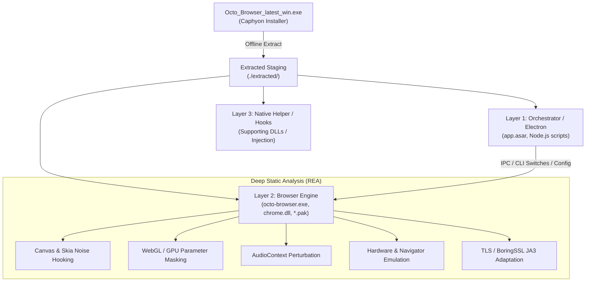

# Design Document: Static Reverse Engineering Octo Browser (Anti-Detect & Chromium Engine Analysis)

**Date**: 2026-11-13  
**Status**: Approved by User  
**Target File**: `Octo_Browser_latest_win.exe` (Caphyon Advanced Installer v3.2.4)  
**Scope**: 100% Offline Static Analysis — Arsitektur Anti-Detect, Modifikasi Chromium Engine (Canvas, WebGL, Audio, Hardware, Navigator, TLS/JA3/JA4). Tanpa registrasi/login akun atau cloud sync.

---

## 1. Executive Summary & Objective

Tujuan dari proyek ini adalah melakukan reverse engineering statis (offline) terhadap paket instalasi dan file biner Octo Browser (`Octo_Browser_latest_win.exe`) untuk:
1. Membongkar struktur kemasan instalasi (Caphyon Advanced Installer / MSI).
2. Mengidentifikasi arsitektur internal aplikasi (Electron/Node.js client vs. patched Chromium core engine).
3. Memetakan mekanisme transmisi parameter profil anti-detect dari lapisan GUI ke engine browser.
4. Menganalisis modifikasi dan patch pada Chromium core (`chrome.dll` dan pustaka pendukung) pada vektor-vektor fingerprinting utama:
   - **Canvas Rendering**: Titik injeksi noise pada Skia pipeline & 2D context extraction.
   - **WebGL & GPU**: Masking query `UNMASKED_VENDOR_WEBGL` / `UNMASKED_RENDERER_WEBGL`, shader precision formats, dan context attributes.
   - **Audio Context**: Perturbasi data frekuensi audio (`AnalyserNode` / `AudioBuffer`).
   - **Navigator & Hardware**: Override `hardwareConcurrency`, `deviceMemory`, `platform`, screen geometry, dan fonts.
   - **Network & TLS Stack**: Konfigurasi BoringSSL terkait ordering cipher suites dan ekstensi TLS (JA3/JA4 fingerprinting).

*Catatan Batasan*: Investigasi ini berfokus murni pada aspek teknis client & engine secara lokal. Tidak melibatkan pendaftaran akun, autentikasi cloud, login flow, maupun interaksi jaringan live.

---

## 2. Architecture & Pipeline

---

## 3. Tahapan Investigasi Detail

### Tahap 1: Offline Extraction & Inventory
- Ekstraksi payload dari Caphyon Advanced Installer ke direktori staging lokal `./extracted/` tanpa menjalankan installer sistem.
- Inventarisasi seluruh file output: file PE (EXE/DLL), arsip paket Electron (`app.asar`), resource PAK, dan manifes.

### Tahap 2: Analisis Lapisan Orchestrator (Electron / ASAR)
- Unpack `app.asar` ke `./extracted/asar_unpacked/`.
- Memeriksa kode peluncuran browser (browser launcher / process spawner) untuk mencatat semua flag, environment variable, atau parameter CDP yang diteruskan ke Chromium engine saat profil diinisialisasi.

### Tahap 3: Analisis Komponen Chromium Engine (`chrome.dll`)
- Melakukan analisis binary statis menggunakan tool REA (Reverse-Engineer-Anything) dan disassembler pada modul inti browser:
  1. **Canvas**: Pencarian referensi string dan implementasi `toDataURL`, `getImageData`, serta rutin noise Skia.
  2. **WebGL**: Pemeriksaan fungsi dispatch query WebGL (`getParameter` untuk konstanta 0x9245 dan 0x9246).
  3. **Audio**: Penelusuran fungsi `getFloatFrequencyData` dan `AudioDestinationNode`.
  4. **Hardware/Platform**: Penelusuran binding V8 ke atribut `navigator`.
  5. **TLS**: Pengecekan tabel ekspor/impor dan string BoringSSL terkait TLS handshake dan cipher suites.

---

## 4. Deliverables

Laporan akhir hasil reverse engineering akan mencakup:
1. **Daftar Komponen & Struktur File**: Pemetaan direktori dan file biner hasil ekstraksi.
2. **Katalog Command-Line Flags / Configuration Schema**: Parameter profil yang digunakan untuk mengontrol engine.
3. **Peta Teknis Patch Engine (Vektor per Vektor)**: Rincian teknis modifikasi kode pada Canvas, WebGL, Audio, Hardware, dan TLS.
4. **Ringkasan Temuan**: Penilaian arsitektur implementasi anti-detect (deterministik berbasis seed profil vs. noise acak).
