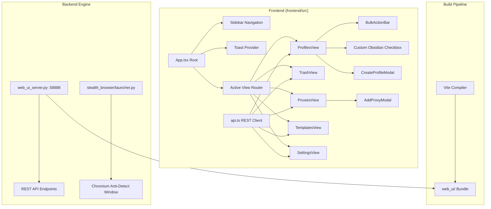

# Octo Browser React UI Migration Implementation Plan

> **For agentic workers:** REQUIRED SUB-SKILL: Use superpowers:subagent-driven-development (recommended) or superpowers:executing-plans to implement this plan task-by-task. Steps use checkbox (`- [ ]`) syntax for tracking.

**Goal:** Rebuild the Octo Browser Offline Studio user interface using React 19, TypeScript, and Vite into a modular single-page application with 100% feature parity, custom Obsidian dark theme, and zero-flicker reactive state management.

**Architecture:** A modern React SPA source tree in `frontend/` compiles via Vite directly into `web_ui/`. The Python server (`web_ui_server.py`) continues serving the static compiled assets on `http://127.0.0.1:58888` while exposing the existing JSON REST endpoints. The desktop launcher batch file launches the Chrome application window seamlessly without requiring a running Node.js daemon.

**Architecture Diagram:**



**Tech Stack:** React 19, TypeScript 5.7, Vite 6, Tailwind CSS / Vanilla CSS Variables, Python 3.15.

**Spec:** [react_ui_migration_design.md](file:///c:/Users/Nel/Documents/Reverse-Engineer-Anything/Octo-Browser/docs/plans/react_ui_migration_design.md)

---

## Global Constraints

- Must run 100% offline with zero cloud account dependency or external CDN network calls.
- Must use Windows-compatible execution commands (`npm.cmd` / `npx.cmd`).
- Palette must strictly match Octo Browser Obsidian Dark (`#0b0d14`, `#10131e`, `#161926`, `#2f54eb`).
- Zero decorative emojis in text, buttons, or headers. SVG iconography only (R-04).
- Must eliminate background polling selection wipes (preserve selected profile checkboxes across updates).
- Python server must serve production bundle from `web_ui/` on port 58888 with identical REST contracts.

---

## Review Focus

1. **Selection Reset during Polling:** When 2 profiles are checked, background status polls must not uncheck them or dismiss the Bulk Action Bar.
2. **Empty State Interactivity:** When 0 profiles exist, the empty state must display informative text with working "+ New Profile" and "Quick Profile" action buttons.
3. **Bulk Action Failures:** If 3 profiles are selected and one fails to start, the UI must report the error via toast and continue processing remaining profiles.
4. **Tag Overflow Handling:** Long profile tags such as `E-Commerce` or `Crypto-Wallet` must never break mid-word across table cells.
5. **Chromium Engine Fallback:** If no custom browser path is set, the sidebar footer must display the automatically detected system engine (e.g. `chrome.exe`) without clipping.

---

## Implementation Tasks

### Task 1: Initialize Vite + React Project in `frontend/`

**Files:**
- Create: `frontend/package.json`
- Create: `frontend/vite.config.ts`
- Create: `frontend/tsconfig.json`
- Create: `frontend/index.html`
- Create: `frontend/src/index.css`
- Create: `frontend/src/main.tsx`

**Interfaces:**
- Produces: Build command `npm.cmd run build` that outputs compiled bundle directly into `../web_ui/`.

- [ ] **Step 1: Create `frontend/package.json` with React 19, TypeScript, and Vite**

```json
{
  "name": "octo-browser-ui",
  "private": true,
  "version": "1.0.0",
  "type": "module",
  "scripts": {
    "dev": "vite",
    "build": "tsc && vite build",
    "preview": "vite preview"
  },
  "dependencies": {
    "react": "^19.0.0",
    "react-dom": "^19.0.0"
  },
  "devDependencies": {
    "@types/react": "^19.0.0",
    "@types/react-dom": "^19.0.0",
    "@vitejs/plugin-react": "^4.3.4",
    "typescript": "^5.7.0",
    "vite": "^6.0.0"
  }
}
```

- [ ] **Step 2: Create `frontend/vite.config.ts` targeting `../web_ui`**

Configure `outDir: '../web_ui'` and `emptyOutDir: true` so the build output drops directly into the directory served by Python.

- [ ] **Step 3: Create `frontend/tsconfig.json` and `frontend/index.html`**

Set up standard React HTML entry and modern JSX compiler options.

- [ ] **Step 4: Create `frontend/src/index.css` with Octo Obsidian Design Tokens**

Include CSS variables:
`--bg-base: #0b0d14`, `--bg-sidebar: #0e111a`, `--bg-card: #131726`, `--primary: #2f54eb`, `--border: #1e2438`, `--text-main: #f1f5f9`, `--text-muted: #94a3b8`, `--text-dim: #64748b`.

- [ ] **Step 5: Run npm install and verify compilation**

Run: `cmd.exe /c "cd frontend && npm.cmd install && npm.cmd run build"`
Expected: Command exits 0 and produces `web_ui/index.html` and `web_ui/assets/`.

- [ ] **Step 6: Commit**

```bash
git add frontend/
git commit -m "feat(frontend): initialize Vite + React TypeScript project scaffolding"
```

---

### Task 2: TypeScript Interfaces and Typed API Client

**Files:**
- Create: `frontend/src/types.ts`
- Create: `frontend/src/api.ts`

**Interfaces:**
- Produces:
  - `Profile`, `ProxyItem`, `Preset`, `AppSettings`, `ApiResponse<T>` types.
  - `api.getProfiles(): Promise<{ profiles: Profile[], trash_count: number, active_engine: string }>`
  - `api.startProfile(name: string): Promise<{ status: string, pid?: number }>`
  - `api.stopProfile(name: string): Promise<{ status: string }>`
  - `api.createProfile(data: CreateProfilePayload): Promise<{ status: string, name: string }>`
  - `api.trashProfile(name: string): Promise<{ status: string }>`
  - `api.openFolder(name: string): Promise<{ status: string }>`
  - `api.getTrash(): Promise<{ items: TrashItem[] }>`
  - `api.restoreTrash(trash_id: string): Promise<{ status: string, name: string }>`
  - `api.purgeTrash(trash_id?: string): Promise<{ status: string, count: number }>`
  - `api.getProxies(): Promise<{ proxies: ProxyItem[] }>`
  - `api.addProxy(data: { title: string, url: string }): Promise<{ status: string, proxy: ProxyItem }>`
  - `api.deleteProxy(id: string): Promise<{ status: string }>`
  - `api.getPresets(): Promise<{ presets: Preset[] }>`
  - `api.getSettings(): Promise<AppSettings>`
  - `api.saveSettings(data: Partial<AppSettings>): Promise<{ status: string }>`

- [ ] **Step 1: Define `frontend/src/types.ts`**

Map exact fields matching backend JSON models (`canvas_seed`, `webgl_renderer`, `is_active`, `pid`, etc.).

- [ ] **Step 2: Implement `frontend/src/api.ts`**

Implement typed fetch wrapper with `Content-Type: application/json` headers and error parsing.

- [ ] **Step 3: Run TypeScript type check**

Run: `cmd.exe /c "cd frontend && npx.cmd tsc --noEmit"`
Expected: Exit code 0, zero type errors.

- [ ] **Step 4: Commit**

```bash
git add frontend/src/types.ts frontend/src/api.ts
git commit -m "feat(frontend): add data contracts and typed REST client"
```

---

### Task 3: Core UI Primitives & Anti-Slop Component Library

**Files:**
- Create: `frontend/src/components/Checkbox.tsx`
- Create: `frontend/src/components/Toast.tsx`
- Create: `frontend/src/components/StatusPill.tsx`
- Create: `frontend/src/components/EmptyState.tsx`
- Create: `frontend/src/components/Modal.tsx`

**Interfaces:**
- Produces:
  - `<Checkbox checked={boolean} indeterminate={boolean} onChange={(checked) => void} ariaLabel={string} />`
  - `<StatusPill isActive={boolean} pid?: number />`
  - `<EmptyState title={string} description={string} icon={ReactNode} actions={ReactNode} />`
  - `<Modal isOpen={boolean} title={string} onClose={() => void}>{children}</Modal>`
  - `useToast()` hook or `<ToastContainer />`

- [ ] **Step 1: Implement `frontend/src/components/Checkbox.tsx`**

Build custom SVG-driven checkbox with dark slate background, `#2d354d` border, hover illumination, checked state with white checkmark, and indeterminate state with white horizontal bar.

- [ ] **Step 2: Implement `frontend/src/components/StatusPill.tsx`**

Render status capsule with green dot for `Aktif (PID ${pid})` and muted slate dot for `Siap`.

- [ ] **Step 3: Implement `frontend/src/components/EmptyState.tsx`**

Render centered empty state container conforming to R-27 with title, description, and action button container.

- [ ] **Step 4: Implement `frontend/src/components/Modal.tsx` and `frontend/src/components/Toast.tsx`**

Build overlay backdrop with Esc key listener, clean close button, and floating 3-second auto-dismiss toast alerts.

- [ ] **Step 5: Typecheck component primitives**

Run: `cmd.exe /c "cd frontend && npx.cmd tsc --noEmit"`
Expected: Exit code 0.

- [ ] **Step 6: Commit**

```bash
git add frontend/src/components/
git commit -m "feat(frontend): implement core anti-slop UI primitives"
```

---

### Task 4: Navigation Sidebar and Header Components

**Files:**
- Create: `frontend/src/components/Sidebar.tsx`
- Create: `frontend/src/components/TopBar.tsx`

**Interfaces:**
- Consumes: `TabId` from `types.ts`, `activeTab`, `setActiveTab`, badge counts.
- Produces:
  - `<Sidebar activeTab={TabId} onSelectTab={(t) => void} profilesCount={number} trashCount={number} proxiesCount={number} activeEngine={string} runningCount={number} />`
  - `<TopBar onNewProfile={() => void} onQuickProfile={() => void} onTestFingerprint={() => void} search={string} onSearchChange={(s) => void} statusFilter={string} onStatusFilterChange={(f) => void} />`

- [ ] **Step 1: Implement `frontend/src/components/Sidebar.tsx`**

Render brand header with Octo logo, 5 navigation items with active styling (`#2f54eb`), badge counters, and pinned sidebar footer showing Chromium engine and active profile statistics.

- [ ] **Step 2: Implement `frontend/src/components/TopBar.tsx`**

Render action buttons with clean inline SVGs (`+ New Profile`, `Quick Profile`, `Test Fingerprint`), search input with magnifying glass icon, and status filter dropdown.

- [ ] **Step 3: Typecheck navigation components**

Run: `cmd.exe /c "cd frontend && npx.cmd tsc --noEmit"`
Expected: Exit code 0.

- [ ] **Step 4: Commit**

```bash
git add frontend/src/components/Sidebar.tsx frontend/src/components/TopBar.tsx
git commit -m "feat(frontend): implement sidebar navigation and top action bar"
```

---

### Task 5: Profiles View with Bulk Actions & Create Modal

**Files:**
- Create: `frontend/src/components/BulkActionBar.tsx`
- Create: `frontend/src/modals/CreateProfileModal.tsx`
- Create: `frontend/src/views/ProfilesView.tsx`

**Interfaces:**
- Consumes: `api`, `Profile`, `Preset`.
- Produces:
  - `<ProfilesView />` managing selection state in `Set<string>`, live status background polling, multi-select bulk operations, row actions, and creation modal.

- [ ] **Step 1: Implement `frontend/src/components/BulkActionBar.tsx`**

Toolbar displaying `N profil dipilih`, `Start Selected`, `Stop Selected`, `Move to Trash`, and `✕ Deselect All`.

- [ ] **Step 2: Implement `frontend/src/modals/CreateProfileModal.tsx`**

Modal with fields: Profile Name (auto-defaulted), Hardware & OS Preset dropdown, Tags input, Proxy input, and submit action.

- [ ] **Step 3: Implement `frontend/src/views/ProfilesView.tsx`**

Full profiles table:
- Checkbox header and row checkboxes wired to `selectedProfiles` set.
- Background status sync every 2 seconds without resetting `selectedProfiles`.
- OS Icons (Windows / macOS SVGs).
- Non-breaking tag pills (`white-space: nowrap`).
- Start / Stop button with optimistic UI and toast feedback.
- EmptyState fallback when profile count is 0.

- [ ] **Step 4: Typecheck Profiles View**

Run: `cmd.exe /c "cd frontend && npx.cmd tsc --noEmit"`
Expected: Exit code 0.

- [ ] **Step 5: Commit**

```bash
git add frontend/src/views/ProfilesView.tsx frontend/src/modals/CreateProfileModal.tsx frontend/src/components/BulkActionBar.tsx
git commit -m "feat(frontend): implement profiles table with selection and bulk actions"
```

---

### Task 6: Trash Bin, Proxies, Templates, and Settings Views

**Files:**
- Create: `frontend/src/modals/AddProxyModal.tsx`
- Create: `frontend/src/views/TrashView.tsx`
- Create: `frontend/src/views/ProxiesView.tsx`
- Create: `frontend/src/views/TemplatesView.tsx`
- Create: `frontend/src/views/SettingsView.tsx`

**Interfaces:**
- Consumes: `api`, `TrashItem`, `ProxyItem`, `Preset`, `AppSettings`.
- Produces: Views for the remaining 4 tabs.

- [ ] **Step 1: Implement `frontend/src/views/TrashView.tsx`**

Table of trashed profiles with trashed date, GPU renderer, `Restore` button, `Delete Permanently` button, and top-right `Empty Trash Bin` button with confirmation.

- [ ] **Step 2: Implement `frontend/src/modals/AddProxyModal.tsx` & `frontend/src/views/ProxiesView.tsx`**

Proxy list with type/url monospace display, date added, delete action, and modal to add HTTP/SOCKS5 proxies.

- [ ] **Step 3: Implement `frontend/src/views/TemplatesView.tsx`**

Cards displaying hardware presets with detailed Canvas/WebGL/WebRTC specs and `Quick Create` button.

- [ ] **Step 4: Implement `frontend/src/views/SettingsView.tsx`**

Form to select detected Chromium engines, set custom executable paths, configure launch URL, and toggle WebRTC LAN IP leak protection.

- [ ] **Step 5: Typecheck all views**

Run: `cmd.exe /c "cd frontend && npx.cmd tsc --noEmit"`
Expected: Exit code 0.

- [ ] **Step 6: Commit**

```bash
git add frontend/src/views/ frontend/src/modals/
git commit -m "feat(frontend): implement trash, proxies, templates, and settings views"
```

---

### Task 7: Root Assembly, Production Build & E2E System Verification

**Files:**
- Modify: `frontend/src/App.tsx`
- Build output: `web_ui/*`
- Verify: automated end-to-end test script `scripts/verify_react_bundle.py`

**Interfaces:**
- Produces: Verified production build in `web_ui/` served cleanly by `web_ui_server.py`.

- [ ] **Step 1: Wire all views into `frontend/src/App.tsx`**

Integrate `Sidebar`, active view switching, global toast provider, and tab state management.

- [ ] **Step 2: Compile production build**

Run: `cmd.exe /c "cd frontend && npm.cmd run build"`
Expected: Compilation succeeds with 0 errors and generates `web_ui/index.html` and `web_ui/assets/*.js`.

- [ ] **Step 3: Write and run verification script `scripts/verify_react_bundle.py`**

Test:
1. `GET /` serves HTML containing root mount point `<div id="root"></div>` and built JavaScript bundles.
2. Static assets `/assets/*.js` and `/assets/*.css` return HTTP 200 with appropriate mime types.
3. Live test: Create profile, verify selection, soft-delete, restore, verify trash counter.

- [ ] **Step 4: Run verification**

Run: `python scripts/verify_react_bundle.py`
Expected: ALL VERIFICATION CHECKS PASS.

- [ ] **Step 5: Clean up temporary test files & Commit**

```bash
git add frontend/ web_ui/
git commit -m "feat(ui): complete React 19 migration with full feature parity"
```

