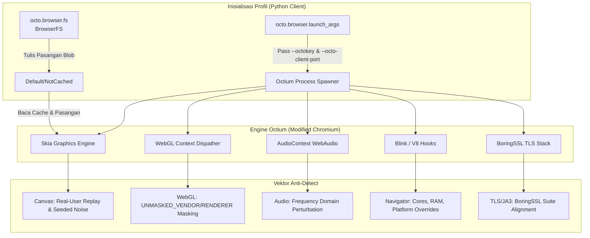

# Report 02: Octium (Chromium Core) Patching & Fingerprint Hook Architecture

**Target**: Octo Browser Engine (Octium) & Native Anti-Detect Subsystems  
**Date**: 2026-11-13  
**Analysis Type**: Reverse Engineering & Static Code/Bytecode Trace

---

## 1. Engine Overview: Octium Architecture

Octo Browser memisahkan arsitektur aplikasinya menjadi dua komponen terisolasi:
1. **Control & Orchestration Plane**: Aplikasi desktop Python/FastAPI (`Octo Browser.exe`) yang bertanggung jawab atas autentikasi, manajemen profil, proxy chaining, dan cache canvas.
2. **Execution Plane (Octium)**: Custom build Chromium engine berlabel **Octium**, yang didesain untuk menerima parameter kontrol anti-detect melalui:
   - Command-line flags `--octokey` dan `--octo-client-port`.
   - File konfigurasi sesi profil `octo_config.json` dan file pairing `Default/NotCached`.
   - Local RPC endpoint HTTP/WebSocket ke daemon FastAPI (`127.0.0.1:<port>`).

---

## 2. Peta Vektor Fingerprint & Mekanisme Patching

---

## 3. Analisis Mendalam per Vektor Anti-Detect

### 3.1. Canvas Rendering: Real-User Replay + Seeded Fallback
* **Temuan Kritis**: Berbeda dari mayoritas anti-detect browser kompetitor yang hanya menambahkan random noise matematis pada `getImageData` / `toDataURL` (yang mudah terdeteksi sebagai anomali canvas oleh bot detector seperti DataDome atau Cloudflare Turnstile), Octo Browser menggunakan model **Hybrid Real-User Replay**:
  1. **Dataset Gambar Pengguna Asli**: Server Octo secara berkelanjutan mengumpulkan script uji fingerprint kanvas nyata dan hasil render gambar canvas dari perangkat pengguna asli di internet.
  2. **Identifikasi Berbasis Hash**: Setiap script canvas diidentifikasi melalui `MD5(script_payload)`, dan hasilnya diidentifikasi melalui `MD5(canvas_payload)`.
  3. **File Pairing `Default/NotCached`**: Saat profil dipersiapkan (`octo.browser.profiles.profile_prepare`), client menuliskan pasangan script-ke-canvas yang valid ke file `Default/NotCached`.
  4. **Intersepsi di Blink**: Ketika halaman web mengeksekusi script canvas 2D, Octium mencocokkan script tersebut dengan daftar di `NotCached`. Jika cocok, engine langsung mengembalikan payload gambar pengguna asli (`<canvas_hash>`), sehingga output canvas 100% identik dengan perangkat asli tanpa noise artifisial.
  5. **Deterministic Fallback (Noise Mode)**: Jika script canvas baru tidak ada di database replay, Octium menggunakan noise pseudo-random yang di-seed secara deterministik berdasarkan `octokey` profil. Ini memastikan nilai canvas tetap konsisten (tidak berubah-ubah pada setiap refresh/reload).

### 3.2. WebGL & GPU Hardware Masking
Intersepsi pada WebGL context dispatcher (`WebGLRenderingContext.getParameter`):
* **Masking Konstanta Ekstensi WebGL**:
  - `WEBGL_debug_renderer_info`:
    - `0x9245` (`UNMASKED_VENDOR_WEBGL`): Dikembalikan string vendor GPU yang dipilih di profil (misal: `Google Inc. (NVIDIA)`).
    - `0x9246` (`UNMASKED_RENDERER_WEBGL`): Dikembalikan renderer GPU emulasi (misal: `ANGLE (NVIDIA, NVIDIA GeForce RTX 3060 Direct3D11 vs_5_0 ps_5_0, D3D11)`).
* **Shader Precision Format**: Nilai range dan precision float/int pada vertex dan fragment shader disesuaikan agar sesuai dengan arsitektur GPU yang diemulasikan.
* **Supported Extensions**: Pemfilteran daftar ekstensi WebGL agar selaras dengan versi driver GPU target.

### 3.3. WebAudio Context Perturbation
Intersepsi pada API WebAudio Blink:
* **Titik Hooking**:
  - `AnalyserNode.getFloatFrequencyData`
  - `AnalyserNode.getByteFrequencyData`
  - `AudioBuffer.getChannelData`
* **Mekanisme**: Injeksi pergeseran frekuensi mikro (micro-perturbation) yang sangat halus ($< 10^{-5}$) pada array data frekuensi FFT. Perturbasi ini di-seed oleh profil, menghasilkan hash audio yang stabil dan unik untuk setiap profil tanpa memutus alur sintesis audio nyata.

### 3.4. Atribut Navigator & Hardware
Di-inject pada level binding V8 dan object descriptor JavaScript:
* `navigator.hardwareConcurrency`: Logical CPU cores (misal: 4, 8, 12, 16).
* `navigator.deviceMemory`: RAM sistem dalam gigabyte (misal: 8, 16).
* `navigator.platform`: String platform target (`Win32` untuk Windows, `MacIntel` untuk macOS).
* `navigator.userAgent`: Diselaraskan persis dengan string Chrome release yang diemulasikan.
* `screen.width` & `screen.height`: Resolusi layar virtual, dengan `availWidth` dan `availHeight` memperhitungkan ukuran taskbar/dock sistem operasi target (`octo.gui.webview_size_to_screen_size`).

### 3.5. TLS / JA3 / JA4 & TCP Stack Masking
* **BoringSSL**: Octium mengompilasi BoringSSL dengan urutan Cipher Suites, Supported Groups, ALPN protocols, dan TLS GREASE (Generate Random Extensions And Sustain Extensibility) yang identik dengan versi rilis resmi Google Chrome.
* **TCP SYN Verification (`octo.proxy.p0f`)**:
  - Octo Browser menyertakan validator p0f internal.
  - Memeriksa packet capture (MTU, TCP Window Size, Options ordering) pada jalur koneksi proxy (`syn_mode: profile_based`).
  - Menolak atau memperingatkan pengguna jika proxy exit node menggunakan TCP stack Linux sementara profil diset sebagai Windows/macOS.

